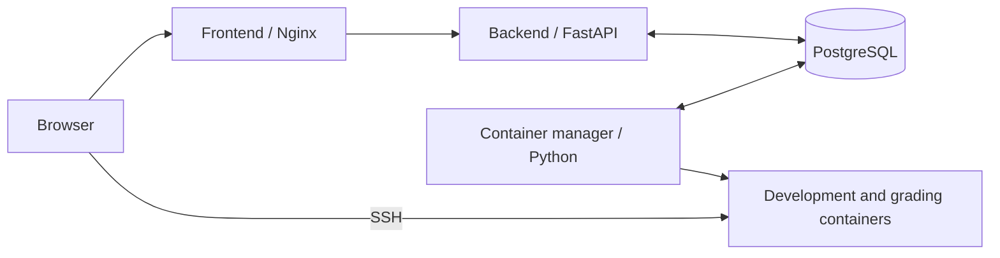

# EvalOps

EvalOps provides practical programming and DevOps exercises with SSH development
environments and automated grading. Students work in Docker containers, submit
an exercise and receive a test report with a snapshot of their submitted files.

**[Get started](GET_STARTED.md)** for setup, accounts and development commands.
[Tests](tests/README.md) cover the real backend, manager and five-student SSH workflow.

## Architecture

The backend records requests in PostgreSQL. The container manager reads them,
executes Docker actions and writes back results. Database notifications wake the
manager; periodic polling also finds pending work. The backend and manager
communicate through PostgreSQL.

| Component | Responsibility |
| --- | --- |
| [Frontend](frontend/README.md) | Static console for courses, environments, reports, profile and admin monitoring |
| [Backend](backend/README.md) | Session authentication, API access, quotas and transactional admission |
| [Container manager](container_manager/README.md) | Course loading, container lifecycle, grading and recovery |
| [Database](db/schema.sql) | Accounts, catalog, pending operations and evaluation history |
| [Courses](courses/) | YAML definitions, exercise subjects, resources and Docker images |

## Student workflow

1. Sign in, register a public SSH key and choose an exercise.
2. Start the exercise's environment and connect over SSH.
3. Submit for evaluation while that environment is running.
4. Read the report or download the submitted workspace. Restart development to
   continue working or submit again.

## Operating rules

- One running development container per student; files persist after it stops.
- One manager per Docker host, with one action loop. Grading and other actions
  execute sequentially across students.
- Grading stops development first and locks controls until cleanup is confirmed.
- Deadlines and evaluation quotas are enforced by the backend. Invalid grading
  requests do not create an evaluation or consume quota.
- Test failures produce `completed` with `is_success=false`; infrastructure errors
  produce `failed` or `timeout`. Previous successful completion remains recorded.
- Account creation and role changes use the backend CLI.

Docker Compose runs the four application services. Nginx serves the console and
proxies the API at `http://localhost:8080`; an external proxy can provide HTTPS.
PostgreSQL and the runtime data directory hold persistent data.
